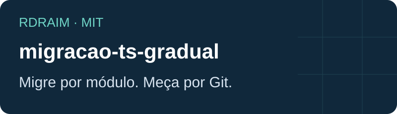
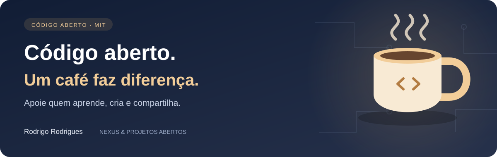

<p align="right">
  <a href="README.md"></a>
  <a href="README.en-US.md"></a>
  <a href="README.es-AR.md"></a>
</p>

# Migração gradual de JavaScript para TypeScript

<!-- public-badges:start -->
[](LICENSE) [](https://github.com/Rdraim/migracao-ts-gradual/actions) [](https://github.com/Rdraim/migracao-ts-gradual/releases) [](https://github.com/Rdraim/migracao-ts-gradual/commits/main)
<!-- public-badges:end -->

<p align="center"></p>

JS e TS convivem: habilite allowJs e faça a checagem com checkJs ou JSDoc. Migre por módulo, preserve testes e valide o consumidor. Renomear arquivos não garante segurança de tipos.

O bundler pode transpilar sem checar tipos. Mantenha TypeScript fixado nas devDependencies do seu projeto e execute tsc --noEmit no CI. O núcleo deste repositório não instala compilador nem modifica fontes.

Node 22.18 ou superior habilita remoção de tipos por padrão; 22.6–22.17 exige --experimental-strip-types. A remoção não checa tipos, não lê tsconfig, não suporta TSX e exige sintaxe apagável. Use build para JavaScript quando esses limites não servirem. Separe a configuração do bundler da configuração de execução Node.

[Node.js](https://nodejs.org/api/typescript.html) · [allowJs](https://www.typescriptlang.org/tsconfig/allowJs.html) · [checkJs](https://www.typescriptlang.org/tsconfig/checkJs.html)

## Uso

Node.js 22 ou superior. Núcleo ESM sem dependências, utilizável em navegador moderno. Não publicado no npm: clone o repositório ou use uma revisão Git fixada. Preserve a licença ao copiar o módulo.

```bash
git clone https://github.com/Rdraim/migracao-ts-gradual.git
cd migracao-ts-gradual
npm test
npm run example
npm run example:integration
```

```js
import { progresso, contarAny, classificar } from './src/progresso.js';
progresso(['a.ts', 'b.js', 'types.d.ts']); // { total: 2, ts: 1, js: 1, pct_ts: 50 }
contarAny('x: any[]; y as any'); // 2
classificar('Component.tsx'); // 'ts'
```

[tsconfig](examples/tsconfig.base.json)

## Limites

progresso mede arquivos, não linhas nem qualidade. Declarações .d.ts/.d.mts/.d.cts não contam como implementação. contarAny é heurística textual: conta tokens comuns, também em comentários/strings; não detecta todos os tipos explícitos ou implícitos. Use o compilador/linter para avaliação real.

## Verificação

CI em Node 22 e 24, exemplos executáveis, testes de borda e revisão heurística de conteúdo/histórico. A revisão automática não substitui inspeção humana.

## Contribuição

Abra uma Issue com comportamento esperado e exemplo sintético. Para contribuir, envie PR com teste de regressão e documentação sincronizada nas três línguas. Não envie dados reais, logs, configurações ou credenciais.

## Segurança

Reporte vulnerabilidades pelo recurso privado de segurança do GitHub quando disponível. Não publique segredos nem dados pessoais em Issues. O núcleo não acessa rede, banco ou arquivos; valide contratos e limites no consumidor.

## Histórico

1.1.0 — 2026-10-12: CI Node 22/24, revisão de histórico, declarações excluídas do progresso, contagem sem duplicação de any[] e documentação atualizada.

## Licença

[MIT](LICENSE) © Rodrigo Rodrigues

## Documentação completa

[API e receitas](API.md) · [Compatibilidade](COMPATIBILITY.md) · [Contribuição](CONTRIBUTING.md) · [Segurança](SECURITY.md) · [Histórico](CHANGELOG.md) · [Apoio voluntário](SUPPORT.md)

## Contratos TypeScript

Declarações .d.ts acompanham o pacote; o núcleo continua JavaScript ESM. Exemplos de tipos em test-types/consumer.mts foram verificados com o compilador já disponível, sem acrescentar dependências. O CI executa testes de runtime e conteúdo; não instala um compilador TypeScript.

Para repetir a verificação, use o TypeScript instalado no seu ambiente:

```bash
tsc --noEmit --strict --target ES2022 --module NodeNext --moduleResolution NodeNext test-types/consumer.mts
```

## Nova versão — 1.2.0

Acrescenta medição pelo índice Git, contratos TypeScript, testes com repositório sintético e documentação completa.

Os indicadores são condicionais: CI apenas aprovado, release estável publicada e estrelas/forks acima de zero. Atualização agendada a cada seis horas e por eventos; uma página aberta precisa ser recarregada.

## Medição pelo Git

Depois do clone, execute para um checkout local. A saída JSON contém somente contagens, sem nomes de arquivo nem conteúdo:

```bash
node tools/progresso-git.mjs ./example-project
```

A ferramenta Git lê apenas nomes no índice. Conta testes e ferramentas versionados se suas extensões forem de implementação; filtrar por módulos continua sendo decisão do consumidor. Arquivos removidos do disco mas ainda no índice contam. Não executa commit, push, checkout, instalação ou checagem de tipos. Percentual alto não demonstra qualidade; preserve testes e revise os any.

---

<p align="center">
  
</p>

## ☕ Me pague um café

Este projeto te ajudou a resolver um problema, aprender algo novo ou dar os primeiros passos no desenvolvimento? Se você sentir vontade de apoiar meu trabalho, um café é uma forma carinhosa de agradecer.

Sou **Rodrigo Rodrigues**, criador do **Nexus** e destes projetos de código aberto. Seu apoio me ajuda a dedicar tempo para melhorar o código, escrever exemplos mais claros e continuar compartilhando o que aprendo.

**Contribua com o valor que fizer sentido para você. O apoio é totalmente voluntário — o projeto continua gratuito sob a licença MIT.**

<p>
  <a href="#apoie-com-pix"></a>
  <a href="https://github.com/Rdraim/migracao-ts-gradual/issues/new?title=Coment%C3%A1rio%3A%20este%20projeto%20me%20ajudou"></a>
</p>

### Apoie com Pix

No aplicativo do seu banco, escaneie o QR Code ou copie a chave Pix abaixo. Escolha o valor e confira os dados do destinatário antes de confirmar.

<p align="center">
  
</p>

**Chave Pix**

```text
8875a24e-44d1-4c91-b6bb-62c9f0070955
```

Você também pode apoiar compartilhando o projeto, relatando um problema, melhorando a documentação ou deixando um comentário.

### Seu comentário também faz diferença

[Conte como o projeto te ajudou](https://github.com/Rdraim/migracao-ts-gradual/issues/new?title=Coment%C3%A1rio%3A%20este%20projeto%20me%20ajudou). Vou gostar de saber o que você criou, o que aprendeu e o que poderia ficar mais claro para quem está começando.

O comentário é bem-vindo com ou sem doação. Preserve sua privacidade: não publique comprovantes, dados pessoais, credenciais ou informações de usuários nas Issues.

---

**Obrigado por apoiar meu trabalho e me ajudar a continuar criando e compartilhando. ❤️**
